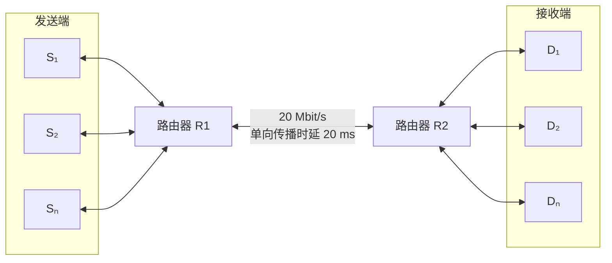

# TCP 参数调优的设计与实验方法

TCP 遇到拥塞时需要决定保留多少在途数据。本项目在 ns-3.49 中比较 Reno、CUBIC 和 GLM 控制的 Reno，检查模型根据发送端的 RTT、重传与确认速率选择窗口保留比例后，吞吐量、时延及带宽分配如何变化。

网络行为由 C++ 仿真程序执行，Python 负责配置校验、模型调用、进程管理和分析。[使用说明](../README.md)提供操作入口，[验证报告](VALIDATION.md)给出实测条件和复现步骤。

**网络使用共享瓶颈的哑铃拓扑。** 每对端点建立一条持续提供数据的 TCP 连接。`Sᵢ` 向 `Dᵢ` 发送数据，ACK 沿原路径返回；正向连接共同竞争 R1 到 R2 的发送容量。



图中端点数量由 `flows` 决定。接入链路为 1 Gbit/s，默认单向时延为 1 ms；基础传播 RTT 为 `2 × (1 + 20 + 1) = 44 ms`。中间链路双向各有独立发送容量和队列。默认瓶颈 FIFO 为 110000 字节，对应 `20 × 10⁶ × 0.044 ÷ 8` 的传播带宽时延积。

接入接口使用 16 MiB FIFO，所有设备发送队列为 1 个数据包。应用持续向 TCP 提交数据直至 `stop_s`；已提交的数据继续传输至完成或 `end_s`。记录接收完成时间以及截止时待交付字节数。

**TCP 算法与恢复机制分别配置。**

| `algorithm` | 执行内容 |
| --- | --- |
| `reno` | 通过观测类调用 ns-3 `TcpLinuxReno` 的窗口增长和阈值计算 |
| `cubic` | 通过观测类调用 `TcpCubic`，保留 HyStart，标准丢包保留比例为 0.7 |
| `glm` | 使用 Reno 增长机制，由 GLM 选择下一次阈值计算使用的比例 |
| `fixed` | 使用与 GLM 相同的阈值公式，整个连接使用配置中的固定比例 |

`recovery=prr` 使用 `TcpPrrRecovery`，`recovery=classic` 使用 `TcpClassicRecovery`，作用于该场景的全部连接。`TcpLinuxReno` 的名称表示算法参照来源；窗口、ACK、重传和计时器均通过 ns-3 仿真对象执行。

**模型决策以完整的 1 s 观测窗口为单位。** 每条连接在实际启动后 1 s 产生首次观测，后续每秒观测一次。仍在提交数据或仍有未确认数据时继续观测。每次输入携带最近最多五个窗口及上一动作的信息。

| 输入 | 单位与含义 |
| --- | --- |
| `window`、`end_s`、`duration_s` | 窗口编号、结束时间和长度 |
| `rtt_mean_ms`、`rtt_p95_ms`、`rtt_samples` | 当前窗口的平均 RTT、P95 和实际样本数量 |
| `min_rtt_ms`、`srtt_ms` | 连接历史最小 RTT、窗口末的平滑 RTT |
| `rtt_inflation` | 平均 RTT 除以历史最小 RTT，再减去 1 |
| `tx_bytes`、`retrans_bytes` | 窗口内全部发送和重传的有效载荷字节数 |
| `retransmission_ratio` | 重传字节数除以全部发送字节数 |
| `ack_rate_bps` | 新确认的累计数据字节数乘以 8，再除以窗口长度 |
| `cwnd_bytes`、`ssthresh_bytes` | 窗口末的拥塞窗口和慢开始阈值 |
| `congestion_state` | TCP 拥塞状态 |
| `previous_action` | 前次比例、决策编号、启用时间及最近阈值计算时间 |

RTT 来自 TCP 实际提交给估计器的样本；没有样本的字段为 `null`。控制输入的 P95 取排序后第 `ceil(0.95 × 样本数)` 个样本。发送端使用重传比例作为传输受损信号，实际丢包位置由仿真记录单独用于评价。

模型输入包含本连接观测，实际瓶颈容量、队列内部状态、误码概率和未来变化保存在实验配置与评价记录中。提示词位于 [prompt.txt](../python/tcp_lab/prompt.txt)，每次运行保存提示词内容和哈希。

**模型输出一个受约束的控制动作。** `beta` 从 `{0.4, 0.5, 0.6, 0.7, 0.8}` 中选择，表示窗口保留比例；`decision_id` 对应输入编号；`diagnosis` 为最新窗口的丢包原因分类；`evidence` 引用一至两个观测指标；`reason` 解释依据。

分类值为 `queue_loss`、`random_loss`、`mixed_loss`、`no_loss` 或 `uncertain`。响应通过结构与取值校验后，在观测时间加 `decision_delay_s` 时启用。首次模型动作之前，GLM 连接使用比例 0.5。

发生拥塞并调用 `GetSsThresh()` 时，程序计算：

$$
ssthresh=MSS\cdot\max\left(2,\left\lfloor\frac{\beta\cdot cwnd}{MSS}\right\rfloor\right)
$$

`cwnd` 和 `ssthresh` 的单位为字节，阈值向下取整为 MSS 的整数倍，下限为 2 MSS。正常窗口增长、快重传、恢复和超时后的窗口重置由 TCP 执行。`action` 记录比例启用，`threshold_compute` 记录实际阈值计算；同一个决策可以用于多次拥塞事件。

**API 等待与仿真时间分别处理。** Python 调用 `glm-4-flash-250414`，请求采用 `stream=false`、`do_sample=false`、JSON 模式和 512 tokens 输出上限。请求总期限为 60 s，项目内通过 filelock 串行调用，锁等待期限为 120 s。客户端保存请求、响应、排队时间和实际耗时，错误会终止当前运行。

等待 API 时，C++ 在观测时刻等待动作消息，仿真时间暂停。`decision_delay_s=0` 表示在当前仿真时刻启用；正值表示安排未来的启用事件。延迟为 1 s 时，已到期动作先启用，再采集下一窗口观测。真实 API 耗时由 `transport.json` 记录。

**JSON 配置以当前配置模型为准。** [config.py](../python/tcp_lab/config.py)检查字段、数值范围和时间关系，并补齐默认值。下表中的时间均为仿真时间。

| 顶层字段 | 默认值 | 单位、范围与作用 |
| --- | --- | --- |
| `name` | `stable` | 非空字母、数字、下划线或连字符组成的场景名 |
| `seed` | 73 | 随机种子，整数 1 至 2147483647 |
| `run` | 1 | 正整数，选择独立运行的随机子流 |
| `end_s` | 210 | 秒，大于 0；仿真截止时间 |
| `rate_mbps` | 20 | Mbit/s，大于 0；瓶颈两个方向的初始速率 |
| `delay_ms` | 20 | 毫秒，大于 0；瓶颈单向传播时延 |
| `queue_bytes` | 110000 | 字节，至少 1500；瓶颈出口 FIFO 容量 |
| `error_rate` | 0 | 0 至 1；正向瓶颈接收端按包丢弃概率 |
| `start_jitter_s` | 0.1 | 秒，0 至 0.1；连接启动时间增加的均匀随机偏移上界 |
| `decision_delay_s` | 0 | 秒，0 至 1；模型动作的仿真启用延迟 |
| `sample_s` | 0.1 | 秒，大于 0；`samples.csv` 的采样周期 |
| `initial_cwnd` | 10 | MSS 数量，正整数；所有连接的初始窗口 |
| `initial_ssthresh` | 4294967295 | 字节，整数 2896 至 4294967295；初始慢开始阈值 |
| `sack` | `true` | 是否启用 SACK |
| `delayed_ack` | 2 | 整数 1 或 2；触发确认的数据段计数 |
| `recovery` | `prr` | `prr` 或 `classic`；TCP 恢复算法 |
| `pcap` | `false` | 是否生成 Point-to-Point 设备的 PCAP |
| `packet_events` | `false` | 是否额外记录逐包 `tcp_tx`、`tcp_ack` |
| `drop_indices` | `[]` | 非负整数列表；指定正向瓶颈接收包的从零开始的序号 |
| `outage_start_s`、`outage_end_s` | `null` | 中断开始和结束时间；区间内正向接收丢弃概率为 1，之后恢复 `error_rate` |
| `ablation` | `none` | `none`、`rtt_history`、`retransmission`、`feedback`；控制模型输入消融 |
| `flows` | 一条默认 Reno 连接 | 1 至 32 个连接配置，见下表 |
| `changes` | `[]` | 按时间递增的瓶颈变化事件 |
| `evaluation` | `[[20,180]]` | 每项为 `[开始秒,结束秒]`，用于左闭右开的指标统计 |

`sample_s` 控制结果文件采样，模型观测周期固定为 1 s。`drop_indices` 包含到达该设备的数据包序列，握手包也参与计数。确定性丢包配置要求 `error_rate=0`，并与中断场景分开使用。

| `flows` 内字段 | 默认值 | 单位与作用 |
| --- | --- | --- |
| `algorithm` | `reno` | `reno`、`cubic`、`glm` 或 `fixed` |
| `beta` | 0.5 | 五个允许比例之一；`fixed` 连接使用该值，`glm` 由模型选值，标准算法使用其自身实现 |
| `start_s` | 1 | 非负秒数，实际启动时再加入随机偏移 |
| `stop_s` | 180 | 正秒数；应用停止提供新数据的时间 |
| `access_delay_ms` | 1 | 正毫秒数；该连接两侧接入链路各自的单向传播时延 |
| `reverse` | `false` | 为 `true` 时，从拓扑右侧向左侧发送数据 |

每条连接满足 `start_s + start_jitter_s < stop_s < end_s`。中断时间满足 `0 < outage_start_s < outage_end_s < end_s`，两个字段同时提供。每个统计区间满足 `0 ≤ 开始 < 结束 ≤ end_s`。

`changes` 的每项包含必填 `time_s`，以及至少一个 `rate_mbps` 或 `delay_ms`。时间大于 0、小于 `end_s`，并严格递增；速率和时延为正值。调整速率时，两侧瓶颈设备共同更新；已开始发送的数据包沿用已安排的完成事件。队列字节容量保持原值。

代码固定的设置包括：接入速率 1 Gbit/s、Point-to-Point MTU 默认 1500 字节、MSS 1448 字节、发送和接收缓冲区各 16 MiB、Timestamp 与窗口扩大开启、ECN 关闭、最小重传超时 1 s、接入 FIFO 16 MiB、设备队列 1 个数据包。具体实现见 [topology.cc](../cpp/topology.cc)。

**容量变化配置描述一个完整实验。** 下面的配置与生成器的 `capacity-reno-01.json` 对应；省略的诊断开关和字段采用上表默认值。

```json
{
  "name": "capacity-reno",
  "seed": 73,
  "run": 1,
  "end_s": 210,
  "rate_mbps": 20,
  "delay_ms": 20,
  "queue_bytes": 110000,
  "error_rate": 0,
  "start_jitter_s": 0.1,
  "decision_delay_s": 0,
  "sample_s": 0.1,
  "initial_cwnd": 10,
  "initial_ssthresh": 4294967295,
  "sack": true,
  "delayed_ack": 2,
  "recovery": "prr",
  "flows": [{
    "algorithm": "reno",
    "start_s": 1,
    "stop_s": 180,
    "access_delay_ms": 1,
    "reverse": false
  }],
  "changes": [
    {"time_s": 60, "rate_mbps": 5},
    {"time_s": 120, "rate_mbps": 20}
  ],
  "evaluation": [[20,60], [80,120], [140,180]]
}
```

这条连接在 1 s 加随机偏移后启动，经历 20、5、20 Mbit/s 三个容量阶段，180 s 停止供给数据，210 s 结束仿真。三个评价区间避开每次容量变化后的前 20 s，用于计算阶段吞吐量；恢复时间另外分析变化后的过程。

在具备 C++23 编译器、CMake、Ninja、uv 和 ns-3.49 的环境中，以下命令完成构建、生成配置、执行与分析。命令从项目根目录运行，输出目录应尚未存在：

```bash
bash scripts/build.sh
uv run --locked tcp-lab matrix --output results/design-configs --runs 1
uv run --locked tcp-lab run results/design-configs/capacity-reno-01.json --output results/design-run
uv run --locked tcp-lab analyze results/design-run
```

`matrix --runs 1` 为 96 个场景各生成一个配置。上述 `run` 选择其中的容量变化 Reno 场景；GLM 场景使用相应文件并需要 `ZHIPU_API_KEY`。运行后的 `config.json` 展示完整默认值，`metrics.json` 按三个区间给出有效吞吐量和时延；恢复时间需按[验证报告](VALIDATION.md)提供无损参考值。

**实验矩阵围绕具体网络问题组织。**

| 场景类型 | 变化条件 | 评价目的 |
| --- | --- | --- |
| 稳定容量 | 5、20、50 Mbit/s | 检查稳态资源利用和时延 |
| 容量变化 | 60 s 降至 5 Mbit/s，120 s 恢复 20 Mbit/s | 检查响应与恢复 |
| 随机丢包 | 概率 0.001、0.005、0.01 | 检查 RTT 与重传信息的联合使用 |
| 同类与混合竞争 | 2、4、8 条同类连接；两类、三类算法排列 | 检查带宽份额和公平性 |
| 不同 RTT | 接入时延 1、21 ms，对应传播 RTT 44、124 ms | 检查 RTT 差异下的分配 |
| 连接变化 | 4 条初始连接，60 s 加入 4 条，新增连接 120 s 停止供给 | 检查竞争规模变化 |
| 队列容量 | 27500、110000、440000 字节 | 检查缓冲容量与排队时延 |
| 传播时延 | 60 s 将瓶颈单向时延增加至 40 ms | 检查时延原因判断 |
| 反向流量 | 60 至 120 s 加入反向 CUBIC 流 | 检查 ACK 所经方向的排队影响 |
| 决策延迟 | 0、0.1、0.5、1 s | 检查观测过时的影响 |
| 固定比例 | 五个允许比例，分别运行稳定和变化容量 | 比较固定选值与动态选值 |
| 输入消融 | 移除历史 RTT、重传信息或前次动作信息 | 检查模型使用的观测依据 |
| 容量参考 | 5、20、50 Mbit/s，无随机丢包、大队列和足够在途数据 | 为恢复时间提供有效吞吐量参考 |

`rtt_history` 将旧窗口的 RTT 字段置为 `null`，保留最新窗口；`retransmission` 移除各窗口的重传字节和比例；`feedback` 移除 `previous_action`，保留网络观测历史。`missing_features` 告知模型缺少的输入。

生成器使用 `seed=73`，独立重复改变 `run`。错误模型使用随机流 1000，连接 i 的启动偏移使用随机流 `2000+i`。相同算法比较复用运行编号与外部配置。完整矩阵为 96 个场景，每场景 20 次重复时产生 1920 项配置。

**指标按明确的时间与数据口径计算。**

| 指标 | 计算方式与判读 |
| --- | --- |
| 有效吞吐量 | 统计区间内接收应用获得的有效数据字节数乘以 8，除以区间时长；单位 bit/s |
| 带宽份额 | 各连接有效吞吐量占所有连接吞吐量之和的比例；混合传输方向时需结合方向信息解释 |
| 链路利用率 | 每个方向实际发送占用时间除以区间长度；跨边界的发送按重叠时间计算 |
| RTT 与队列时延 | RTT 取实际估计器样本；队列等待由进入、离开事件计算；报告使用 NumPy 插值分位数，列出中位数、P95、P99 |
| 丢包率 | 队列丢弃数除以成功入队与入队前丢弃数之和；误码丢弃数除以错误模型检查次数；这两项为整次运行统计 |
| 重传比例 | 重传有效载荷字节数除以全部发送有效载荷字节数；窗口输入与总计数分别保存 |
| 超时事件 | 统计进入 `CA_LOSS` 的状态变化 |
| 模型行为 | 参数启用次数、阈值计算事件及二者的决策编号对应关系 |

Jain 公平性指数为：

$$
J=\frac{(\sum_i G_i)^2}{n\sum_iG_i^2}
$$

分析在连接实际启动和接收完成时划分区间，同一方向的活跃连接分别计算公平性，活跃但无交付的连接保留在分母中。全部吞吐量为零时结果为 `null`。顶层 `jain` 为正向各有效子区间的时长加权平均，`fairness_segments.direction_jain` 同时保留两个方向的结果。

恢复时间使用相同报文与接入参数下的无损容量参考。容量变化后，从第 1 s 开始每隔 0.1 s 计算前 1 s 的有效吞吐量；达到参考值的 90% 并在连续采样点保持至少 3 s 后，取首次达标时刻减去变化时刻。观察范围截止于下一次网络变化或配置中最早的 `stop_s`。结果状态为 `recovered`、`not_reached` 或缺少参考时的 `reference_required`。

诊断标签根据本连接最近 1 s 内实际发生的队列丢弃、误码丢弃及其组合生成。总体准确率包含全部决策，`uncertain` 计为未正确分类；作答覆盖率和明确作答样本的准确率分别统计。解释引用的数值按绝对误差不超过 `10⁻⁶` 核验。

独立运行先各自计算指标，再使用 Student t 分布计算均值的 95% 置信区间；样本数为 1 时区间为 `null`。配对比较使用相同场景、区间与运行编号，保留未配对编号。模型一致性从已有事件序列等间隔选取 30 个观测，每个请求 5 次，按最常见动作或分类的出现次数除以 5 计算一致率。

**源码与运行记录可以逐项对应。**

| 实现 | 职责 |
| --- | --- |
| [controllers.cc](../cpp/controllers.cc) | 标准算法观测和 GLM 阈值公式 |
| [flow.cc](../cpp/flow.cc)、[rtt-observer.h](../cpp/rtt-observer.h) | 发送、接收、ACK、RTT、重传和观测窗口 |
| [topology.cc](../cpp/topology.cc)、[network-monitor.cc](../cpp/network-monitor.cc) | 拓扑、队列、误码和动态网络条件 |
| [experiment.cc](../cpp/experiment.cc) | 采样、决策时序和仿真进程协议 |
| [client.py](../python/tcp_lab/client.py)、[runner.py](../python/tcp_lab/runner.py) | API 校验、串行调用、运行状态与重放 |
| [matrix.py](../python/tcp_lab/matrix.py) | 场景生成与批量执行 |
| [analysis.py](../python/tcp_lab/analysis.py)、[report.py](../python/tcp_lab/report.py) | 指标、统计与图表 |

每次运行保存展开后的配置、软件版本与哈希、原始事件、周期采样、字节计数、运行状态和决策。`analyze` 从完成的运行生成指标与曲线；`report` 汇总已有指标。重放使用同一配置和已保存动作，逐次核查观测，独立模型实验重新调用服务。
