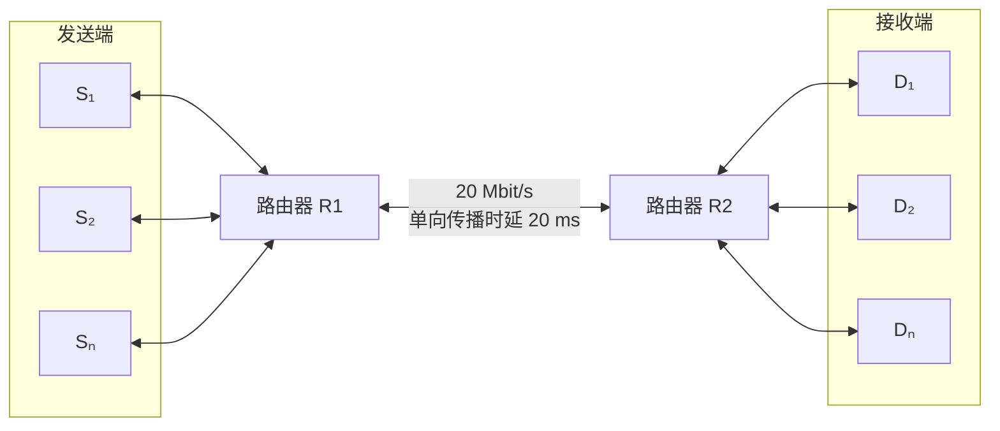

# TCP 参数调优的设计与实验方法

项目在 ns-3.49 中比较 Reno、CUBIC 和 GLM 控制的 Reno，研究发送端观测驱动的窗口保留比例选择。C++ 执行网络与 TCP 行为，Python 负责配置校验、模型调用、进程管理和结果分析。操作入口见 [README](../README.md)，已有实测与复现步骤见 [VALIDATION](VALIDATION.md)。

## 1. 网络模型与 TCP 算法

### 1.1 共享瓶颈拓扑

每对端点建立一条持续供给数据的 TCP 连接。`Sᵢ` 向 `Dᵢ` 发送数据，ACK 沿原路径返回；同向连接共享两个路由器之间的发送容量。



端点数量由连接配置决定。接入链路为 1 Gbit/s，默认单向时延为 1 ms；默认瓶颈为 20 Mbit/s、单向 20 ms，基础传播 RTT 为 `2 × (1 + 20 + 1) = 44 ms`。两个传输方向各有独立发送容量和队列。

默认瓶颈 FIFO 为 110000 字节，对应传播带宽时延积 `20 × 10⁶ × 0.044 ÷ 8`。接入接口使用 16 MiB FIFO，设备发送队列为 1 个数据包。容量变化时保持队列字节容量固定；已开始发送的数据包沿用已安排的完成事件，后续发送使用新速率。

### 1.2 算法与恢复机制

| 算法标识 | 实现行为 |
| --- | --- |
| `reno` | 观测类调用 ns-3 `TcpLinuxReno` 的窗口增长和阈值计算 |
| `cubic` | 观测类调用 `TcpCubic`，保留 HyStart，标准丢包保留比例为 0.7 |
| `glm` | 使用 Reno 增长机制，由模型选择阈值计算使用的比例 |
| `fixed` | 使用与 GLM 相同的阈值公式，整个连接使用指定比例 |

恢复机制独立配置：`prr` 使用 `TcpPrrRecovery`，`classic` 使用 `TcpClassicRecovery`。正常窗口增长、ACK 处理、重传、恢复和超时后的窗口重置均由 ns-3 执行。`TcpLinuxReno` 的名称表示算法参照来源，该类通过跨平台 C++ 仿真对象运行。

应用向 TCP 持续提交数据直至停止供给时间，已提交的数据继续传输至完成或仿真截止。程序分别记录接收完成时间、未确认数据和截止时待交付字节数。

## 2. GLM 决策与执行时序

### 2.1 发送端观测

每条连接在实际启动后 1 s 产生首次观测，随后每秒观测一次。仍在提交数据或仍有未确认数据时继续观测。模型输入包含最近最多五个完整窗口，以及上一动作的信息。

| 输入 | 含义 |
| --- | --- |
| `window`、`end_s`、`duration_s` | 窗口编号、结束秒数和长度 |
| `rtt_mean_ms`、`rtt_p95_ms`、`rtt_samples` | 当前窗口的平均 RTT、P95 和样本数量 |
| `min_rtt_ms`、`srtt_ms` | 连接历史最小 RTT、窗口末的平滑 RTT |
| `rtt_inflation` | 平均 RTT 除以历史最小 RTT，再减去 1 |
| `tx_bytes`、`retrans_bytes` | 当前窗口全部发送和重传的有效载荷字节数 |
| `retransmission_ratio` | 重传字节数除以全部发送字节数 |
| `ack_rate_bps` | 窗口内新获得累计确认的字节数乘以 8，再除以窗口长度 |
| `cwnd_bytes`、`ssthresh_bytes` | 窗口末的拥塞窗口和慢开始阈值 |
| `congestion_state` | TCP 拥塞状态 |
| `previous_action` | 前次比例、决策编号、启用时间及最近阈值计算时间 |

RTT 来自 TCP 实际提交给估计器的样本。窗口没有 RTT 样本时，平均值、P95 和膨胀程度为 `null`；连接尚无 RTT 样本时，历史最小值为 `null`。窗口没有发送数据时，重传比例为 `null`。控制输入的 P95 取排序后第 `ceil(0.95 × 样本数)` 个样本。

发送端重传比例反映传输受损情况，真实丢弃位置由网络事件另行记录。模型读取本连接观测，实际容量、误码概率、队列内部状态和未来变化用于实验配置与评价。提示词位于 [prompt.txt](../python/tcp_lab/prompt.txt)，每次运行保存其内容和哈希。

### 2.2 参数选择与阈值计算

模型输出包含五个字段：`decision_id` 对应输入编号，`beta` 选择窗口保留比例，`diagnosis` 判断最新窗口的丢包原因，`evidence` 引用一至两个观测指标，`reason` 解释依据。

允许比例为 `{0.4, 0.5, 0.6, 0.7, 0.8}`；分类为 `queue_loss`、`random_loss`、`mixed_loss`、`no_loss` 或 `uncertain`。响应通过校验后成为该连接的待启用动作，首次模型动作之前使用比例 0.5。

TCP 在拥塞事件中调用 `GetSsThresh()`，按当时有效比例计算：

$$
ssthresh=MSS\cdot\max\left(2,\left\lfloor\frac{\beta\cdot cwnd}{MSS}\right\rfloor\right)
$$

窗口与阈值的单位为字节，阈值向下取整为 MSS 的整数倍，下限为 2 MSS。`action` 记录比例启用，`threshold_compute` 记录实际阈值计算，二者通过决策编号关联。

### 2.3 调用与仿真时间

Python 调用 `glm-4-flash-250414`，请求采用 `stream=false`、`do_sample=false`、JSON 模式和 512 tokens 输出上限。请求总期限为 60 s；项目内通过 filelock 串行调用，锁等待期限为 120 s。请求、响应、排队时间和实际耗时分别保存，调用或校验错误会终止当前运行。

等待响应时，C++ 在当前观测时刻等待动作消息，仿真时间暂停。动作在观测时间加 `decision_delay_s` 时启用。延迟为 1 s 时，已到期动作先启用，再采集下一窗口观测。真实请求耗时保存在 `transport.json`。

## 3. 配置定义

JSON 配置由 [config.py](../python/tcp_lab/config.py)校验，省略字段采用默认值。所有时间字段均指仿真时间。每次运行保存展开后的完整配置。

### 3.1 场景与网络

| 字段 | 默认值 | 单位、范围与作用 |
| --- | --- | --- |
| `name` | `stable` | 非空字母、数字、下划线或连字符组成的场景名 |
| `seed` | 73 | 随机种子，整数 1 至 2147483647 |
| `run` | 1 | 正整数，选择独立运行的随机子流 |
| `end_s` | 210 | 秒，大于 0；仿真截止时间 |
| `rate_mbps` | 20 | Mbit/s，大于 0；瓶颈两个方向的初始速率 |
| `delay_ms` | 20 | 毫秒，大于 0；瓶颈单向传播时延 |
| `queue_bytes` | 110000 | 字节，至少 1500；瓶颈出口 FIFO 容量 |
| `error_rate` | 0 | 0 至 1；正向瓶颈接收端按包丢弃概率 |
| `start_jitter_s` | 0.1 | 秒，0 至 0.1；连接启动时间增加的均匀随机偏移上界 |
| `sample_s` | 0.1 | 正秒数；`samples.csv` 的采样周期 |

### 3.2 TCP 与观测控制

| 字段 | 默认值 | 单位、范围与作用 |
| --- | --- | --- |
| `initial_cwnd` | 10 | MSS 数量，正整数；初始窗口 |
| `initial_ssthresh` | 4294967295 | 字节，整数 2896 至 4294967295；初始慢开始阈值 |
| `sack` | `true` | 是否启用 SACK |
| `delayed_ack` | 2 | 整数 1 或 2；触发确认的数据段计数 |
| `recovery` | `prr` | `prr` 或 `classic`；恢复算法 |
| `decision_delay_s` | 0 | 秒，0 至 1；模型动作的仿真启用延迟 |
| `ablation` | `none` | `none`、`rtt_history`、`retransmission`、`feedback`；模型输入消融 |
| `pcap` | `false` | 是否生成 Point-to-Point 设备的 PCAP |
| `packet_events` | `false` | 是否额外记录逐包 `tcp_tx`、`tcp_ack` |

模型观测周期固定为 1 s，`sample_s` 控制结果采样。`rtt_history` 将旧窗口的 RTT 字段置为 `null`，保留最新窗口；`retransmission` 移除各窗口的重传字节和比例；`feedback` 移除 `previous_action`。输入中的 `missing_features` 说明缺少的特征。

代码固定的参数包括接入速率 1 Gbit/s、Point-to-Point MTU 默认 1500 字节、MSS 1448 字节、发送与接收缓冲区各 16 MiB、Timestamp 和窗口扩大开启、ECN 关闭、最小重传超时 1 s、接入 FIFO 16 MiB，以及设备队列 1 个数据包。

### 3.3 连接

`flows` 是包含 1 至 32 个对象的列表，每个对象定义一条连接；默认包含一条 Reno 连接。

| 连接字段 | 默认值 | 单位与作用 |
| --- | --- | --- |
| `algorithm` | `reno` | `reno`、`cubic`、`glm` 或 `fixed` |
| `beta` | 0.5 | 五个允许比例之一；`fixed` 使用该值，`glm` 由模型选值，标准算法使用自身实现 |
| `start_s` | 1 | 非负秒数，实际启动时再加入随机偏移 |
| `stop_s` | 180 | 正秒数；停止提供新数据的时间 |
| `access_delay_ms` | 1 | 正毫秒数；两侧接入链路各自的单向传播时延 |
| `reverse` | `false` | 为 `true` 时，从拓扑右侧向左侧发送数据 |

每条连接满足 `start_s + start_jitter_s < stop_s < end_s`。停止供给后，已提交数据继续传输，直至交付完成或仿真截止。

### 3.4 变化事件与统计区间

| 字段 | 默认值 | 内容与约束 |
| --- | --- | --- |
| `changes` | `[]` | 每项包含 `time_s` 和至少一个 `rate_mbps` 或 `delay_ms`；时间严格递增且位于 `(0,end_s)`，速率和时延为正值 |
| `evaluation` | `[[20,180]]` | 每项为统计区间 `[开始秒,结束秒]`，满足 `0 ≤ 开始 < 结束 ≤ end_s`，按左闭右开计算 |
| `drop_indices` | `[]` | 指定正向瓶颈接收包的非负序号，从零计数，握手包参与计数 |
| `outage_start_s`、`outage_end_s` | `null` | 同时提供且满足 `0 < 开始 < 结束 < end_s`；区间内正向接收丢弃概率为 1，之后恢复 `error_rate` |

确定性丢包配置要求 `error_rate=0`，并与中断配置分开使用。速率变化共同更新瓶颈两端设备，队列字节容量保持固定。

### 3.5 容量变化配置示例

下面的配置描述一条 Reno 连接的三个容量阶段，与生成器中的 `capacity-reno-01.json` 对应。其余字段采用前述默认值。

```json
{
  "name": "capacity-reno",
  "seed": 73,
  "run": 1,
  "end_s": 210,
  "rate_mbps": 20,
  "delay_ms": 20,
  "queue_bytes": 110000,
  "start_jitter_s": 0.1,
  "flows": [{"algorithm": "reno", "start_s": 1, "stop_s": 180}],
  "changes": [
    {"time_s": 60, "rate_mbps": 5},
    {"time_s": 120, "rate_mbps": 20}
  ],
  "evaluation": [[20,60], [80,120], [140,180]]
}
```

连接在 1 s 加随机偏移后启动，瓶颈经历 20、5、20 Mbit/s 三个阶段，180 s 停止供给数据，210 s 结束仿真。三个评价区间用于测量各阶段的稳定表现，恢复时间另行分析变化后的过程。生成、运行和分析这一场景的顺序见 VALIDATION 第 5 节。

## 4. 实验设计

| 场景类型 | 变化条件 | 回答的问题 |
| --- | --- | --- |
| 稳定容量 | 5、20、50 Mbit/s | 稳态资源利用和时延如何变化 |
| 容量变化 | 60 s 降至 5 Mbit/s，120 s 恢复 20 Mbit/s | 对容量下降和恢复的响应速度如何 |
| 随机丢包 | 概率 0.001、0.005、0.01 | 模型如何联合使用 RTT 与重传信息 |
| 同类与混合竞争 | 2、4、8 条同类连接，两类及三类算法排列 | 各连接如何分配带宽 |
| 不同 RTT | 接入时延 1、21 ms，对应传播 RTT 44、124 ms | RTT 差异如何影响公平性 |
| 连接变化 | 4 条初始连接，60 s 加入 4 条，新增连接 120 s 停止供给 | 竞争规模变化后如何重新分配资源 |
| 队列容量 | 27500、110000、440000 字节 | 缓冲容量如何影响排队和传输 |
| 传播时延 | 60 s 将瓶颈单向时延增加至 40 ms | 模型如何判断 RTT 变化原因 |
| 反向流量 | 60 至 120 s 加入反向 CUBIC 流 | ACK 所经方向的排队有何影响 |
| 决策延迟 | 0、0.1、0.5、1 s | 观测过时如何影响控制 |
| 固定比例 | 五个允许比例，分别运行稳定和变化容量 | 动态选择与固定选值有何差异 |
| 输入消融 | 移除历史 RTT、重传信息或前次动作 | 哪些输入影响模型决策 |
| 容量参考 | 5、20、50 Mbit/s，无随机丢包、大队列和足够在途数据 | 新容量下可达到的有效吞吐量是多少 |

生成器包含 96 个场景，使用 `seed=73`，独立重复改变 `run`。错误模型使用随机流 1000，连接 i 的启动偏移使用随机流 `2000+i`。算法比较复用运行编号和外部配置；每场景 20 次重复时产生 1920 项配置。

## 5. 指标与统计口径

### 5.1 传输、时延与公平性

| 指标 | 定义 |
| --- | --- |
| 有效吞吐量 | 区间内接收应用获得的有效字节数乘以 8，除以区间时长，单位 bit/s |
| 带宽份额 | 单条连接吞吐量占全部连接吞吐量之和的比例；混合传输方向时结合方向信息解释 |
| 链路利用率 | 各方向发送占用时间除以区间长度，跨边界发送按重叠时间计算 |
| RTT | 区间内汇集各连接的实际 RTT 样本，报告中位数、P95 和 P99 |
| 队列时延 | 根据进入与离开事件计算，按队列分别统计 |
| 丢包率 | 队列丢弃数除以成功入队与入队前丢弃数之和；误码丢弃数除以错误模型检查次数，均统计整次运行 |
| 重传比例 | 重传有效载荷字节数除以全部发送有效载荷字节数 |
| 超时次数 | 进入 `CA_LOSS` 的状态变化次数 |

报告分位数采用 NumPy 插值计算，每连接的平滑 RTT 另外保存在周期采样中。Jain 公平性指数为：

$$
J=\frac{(\sum_i G_i)^2}{n\sum_iG_i^2}
$$

分析在连接实际启动和接收完成时划分区间，同一方向的活跃连接分别计算，活跃但无交付的连接计入分母。全部吞吐量为零时结果为 `null`。顶层 `jain` 是正向各有效子区间的时长加权平均，`fairness_segments.direction_jain` 保留两个方向的结果。

### 5.2 恢复时间

使用相同报文与接入参数下的无损容量参考。容量变化后，从第 1 s 开始每隔 0.1 s 计算前 1 s 的有效吞吐量；达到参考值的 90%，并在连续采样点保持至少 3 s 后，以首次达标时刻减去变化时刻作为恢复时间。

观察范围截止于下一次网络变化或配置中最早的 `stop_s`。结果状态为 `recovered`、`not_reached` 或缺少参考时的 `reference_required`。

### 5.3 模型评价与独立重复

诊断标签由本连接最近 1 s 的实际队列丢弃、误码丢弃及其组合生成。总体准确率包含全部决策，`uncertain` 计为未正确分类；作答覆盖率和明确作答样本的准确率分别统计。解释引用的数值按绝对误差不超过 `10⁻⁶` 核验。

一致性实验从已有观测序列等间隔选取样本。默认 30 个样本各请求 5 次，按最常见动作或分类出现次数除以重复次数，分别计算比例和诊断一致率。

网络指标先按独立运行计算，再使用 Student t 分布估计均值的 95% 置信区间。样本数为 1 时区间为 `null`；配对比较使用相同场景、区间与运行编号，并保留未配对编号。

## 6. 实现与记录

| 实现 | 职责 |
| --- | --- |
| [controllers.cc](../cpp/controllers.cc) | 标准算法观测和 GLM 阈值计算 |
| [flow.cc](../cpp/flow.cc)、[rtt-observer.h](../cpp/rtt-observer.h) | 发送、接收、ACK、RTT、重传和观测窗口 |
| [topology.cc](../cpp/topology.cc)、[network-monitor.cc](../cpp/network-monitor.cc) | 拓扑、队列、误码和动态网络条件 |
| [experiment.cc](../cpp/experiment.cc) | 周期采样、决策时序与进程协议 |
| [client.py](../python/tcp_lab/client.py)、[runner.py](../python/tcp_lab/runner.py) | 模型调用、运行状态与重放 |
| [matrix.py](../python/tcp_lab/matrix.py) | 场景生成与批量执行 |
| [analysis.py](../python/tcp_lab/analysis.py)、[report.py](../python/tcp_lab/report.py) | 指标、统计与图表 |

运行保存完整配置、软件版本和哈希、原始事件、周期采样、字节计数、状态及模型决策。分析读取已完成的记录，汇总读取已有指标。重放使用相同配置和已保存动作，逐次核查观测；独立模型实验重新请求服务。
